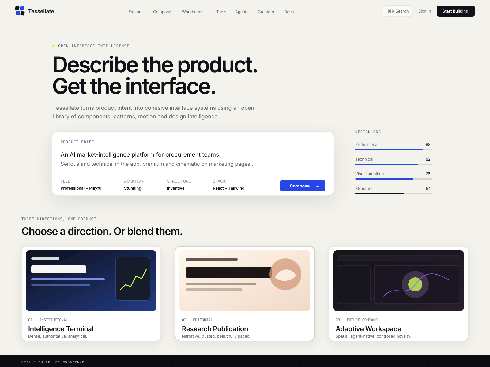
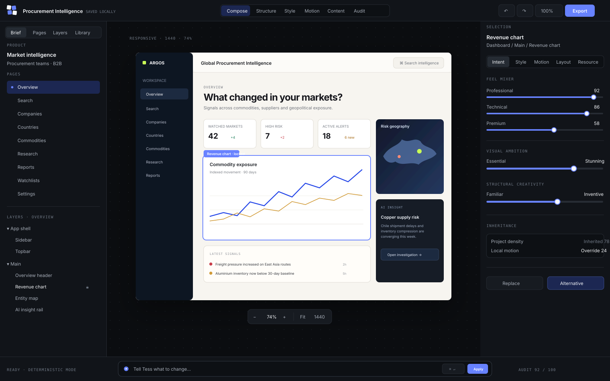

# Tessellate Design References

These boards are implementation north stars, not decorative moodboards.

Read `REFERENCE_DIRECTIONS.md` before implementing major public-site or Workbench UI.

## Homepage — Editorial Instrument

Primary implementation constraints:

- warm off-white editorial shell;
- black/charcoal typography;
- cobalt interaction accent;
- sparse acid-lime signal accent;
- Product Composer is the hero object;
- three design directions appear immediately as proof;
- the platform shell stays calm so resource previews can be expressive;
- no generic purple-glow AI landing-page aesthetic.

## Workbench — Command Studio

Primary implementation constraints:

- near-black professional tool shell;
- 56px toolbar;
- 280px left semantic panel;
- 340px right inspector;
- 64px bottom command bar;
- central canvas is visually dominant;
- cobalt selection states;
- compact inherited/override indicators;
- restrained tool motion;
- generated product provides most of the visual colour.

## Generated-image art direction

`REFERENCE_DIRECTIONS.md` contains four exact image-model prompts for:

1. homepage editorial-instrument direction;
2. Workbench command-studio direction;
3. stunning financial-intelligence showcase;
4. professional + playful HR showcase.

If the active coding/design agent has image generation available, it should generate the specified references and save only selected finals under `design/generated/`. Those generated references are never runtime dependencies and never override functional/buildability constraints.
