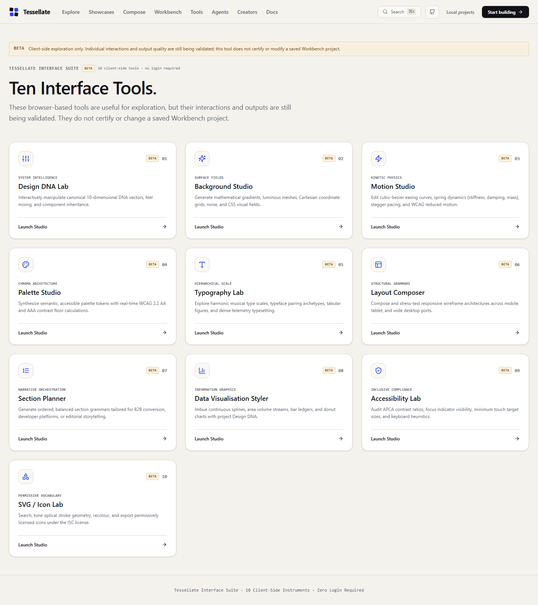
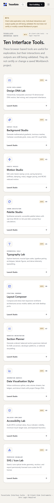
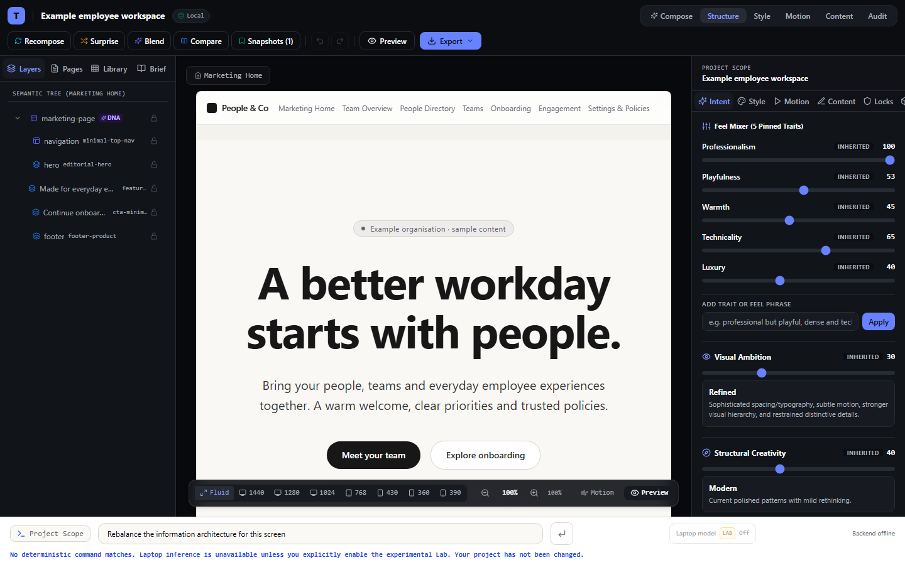
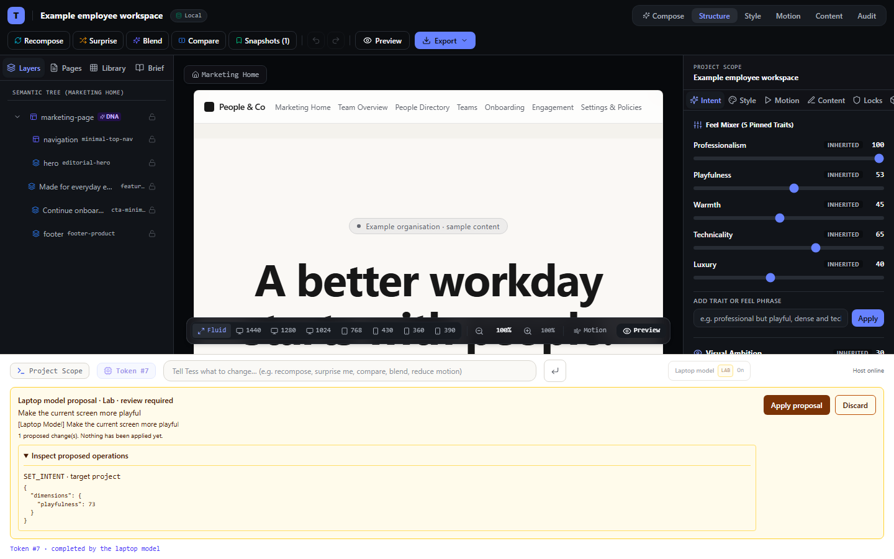
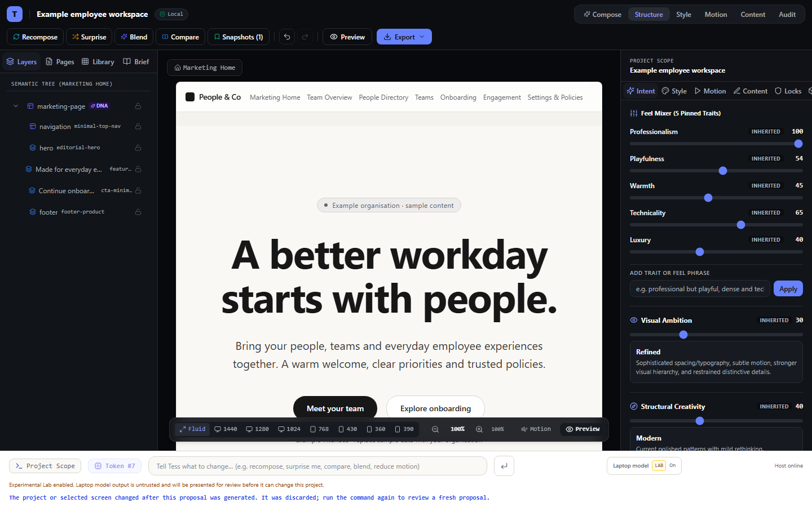

# Step 04 — capability tier evidence

Captured 2026-10-16 on `consolidation/product-hardening`.

## Classification result

All 158 inventory rows now have a Core, Beta or Lab assignment. The distribution
is 86 Core, 63 Beta and 9 Lab. These are support boundaries, not certifications.
The accompanying matrix lists 28 evidence dimensions for each row (4,424 cells);
an untested applicable dimension remains `FAIL` until its ordered hardening gate
records evidence.

`docs/CAPABILITY_TIERS.md` records the tier rules and isolation decisions.
Browser-facing Beta routes disclose limits. The Workbench laptop-model Lab is
off by default, unavailable when its host is offline, and requires review before
an explicit apply. Its proposal is rejected if the project or selected screen
changes while inference is in progress. The semantic search adapter now reports
unavailable and leaves full-text search as the active path. The resource detail
page no longer uses “Core” as a tab badge, and the creator example no longer
claims a verified identity.

## P1 — reviewed DNA proposal silently missed project scope

- **Reproduction:** Open `/workbench` at desktop width, enable the laptop-model
  Lab while its host is available, submit an intent that changes project
  playfulness, then apply its reviewed proposal.
- **Expected:** the project Design DNA changes by the proposed delta; Undo and
  Redo restore the exact values.
- **Before fix:** `planMutationsFromIntent()` wrote the manifest ID into
  project-scope `SET_INTENT` and `SET_DESIGN_TOKEN` mutations. The shared
  executor and inverse treat only the canonical target ID `project` as
  project-scope, so the reviewed operation could report success without changing
  Design DNA. The new regression test failed before the fix: expected 74,
  received 54 after applying a +20 proposal.
- **Fix:** project-scope mutations now use `targetId: 'project'`. The planner
  regression test asserts canonical target selection and applies the resulting
  operation through the shared mutation executor. The E2E test asserts the
  visible value, stale proposal rejection, and exact Undo/Redo behavior.
- **Affected code:** `packages/workbench/src/ai/mutation-planner.ts`;
  `packages/workbench/src/__tests__/ai-layer.test.ts`;
  `packages/workbench/src/components/CommandBar.tsx`.
- **Evidence:**
  [`workbench-lab-review-desktop.png`](evidence/step-04/workbench-lab-review-desktop.png)
  captures the explicit reviewed project-scope proposal;
  [`workbench-lab-redo-desktop.png`](evidence/step-04/workbench-lab-redo-desktop.png)
  shows the applied DNA value after redo. The regression was first confirmed
  red in Vitest and in the browser assertion, then passed after the correction.
- **Verification:** `packages/workbench/src/__tests__/ai-layer.test.ts`;
  `tests/e2e/capability-tiers.spec.ts` (desktop proposal lifecycle); full
  `pnpm test` and `pnpm test:e2e` pass locally.
- **Status:** fixed and verified locally. Deployed verification remains pending
  until the public RC stage; this issue is not marked closed before then.

## Browser evidence

The capability-tier E2E ran at 1440×900 desktop and 390×844 mobile. The Beta
tools notice stays readable and the cards stack at mobile width. The Workbench
Lab screenshot shows explicit opt-in and review controls. The online proposal
test uses a controlled HTTP fixture for the laptop API, so it verifies review,
stale-state protection and mutation/history behavior, not the model's semantic
quality or a live Docker host. The mobile Workbench
Lab test is skipped because the command bar is not rendered in mobile inspection
mode; mobile Workbench usability remains in the responsive hardening steps.

## Quality run

| Command | Result |
| --- | --- |
| `pnpm install --frozen-lockfile` | Passed; lockfile unchanged |
| `pnpm typecheck` | Passed |
| `pnpm lint` | Passed with 0 errors and 51 existing warnings |
| `pnpm test` | 51 files, 454 tests passed |
| `pnpm audit:all` | Passed; release gate 16/16, production build, bundle budgets, provenance and security audits |
| `pnpm test:e2e` | 73 passed, 7 skipped across desktop and mobile Chromium projects |

The build generated 717 Astro pages. The seven E2E skips include mobile-only
Workbench controls not rendered in the mobile inspection shell; they are not
counted as mobile coverage. No public Site deployment was performed during this
step. The existing Site remains unchanged until the ordered public-RC gate.
