# Step 19 — Mutation operations evidence

Step 19 audited mutation controls through the built local Workbench at desktop (1440 × 900) and mobile (390 × 844) sizes. It fixes three user-visible defects and corrects the capability tier for mutation verbs that have no distinct operation contract. This is local verification; public review-site verification remains scheduled for Step 45.

## Findings and before/after evidence

### AUD-152 — Duplicate screens generated a duplicate route and invalid manifest

The baseline UI duplicated the root screen twice as `Marketing Home (Copy)` at `/-copy`. The visible manifest export then failed `ProjectManifestSchema` validation because the screen routes collided. The baseline browser regression failed before the fix; the repaired flow creates unique names/routes and exports a valid manifest.

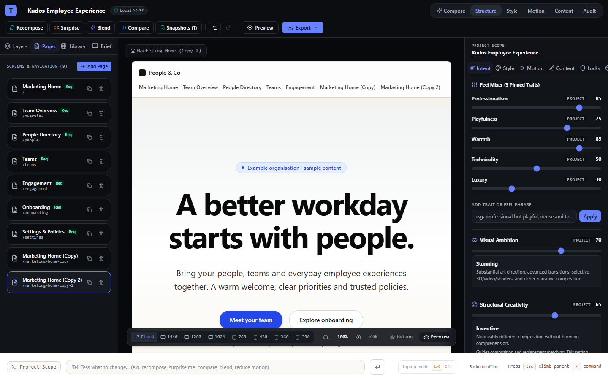

Machine reports: [`before`](evidence/step-19/before/duplicate-screen-collision.json), [`after`](evidence/step-19/after/duplicate-screen-collision.json), and [exported manifest](evidence/step-19/after/duplicate-screen-export.tess.json).

### AUD-153 — Add Page accepted a route already in use

The baseline run submitted `/people`, which was already assigned to People Directory. The screen count rose from 7 to 8 without an error. The repaired form normalizes both routes, refuses the duplicate with an accessible alert, leaves the count at 7, and accepts a subsequent unique route.

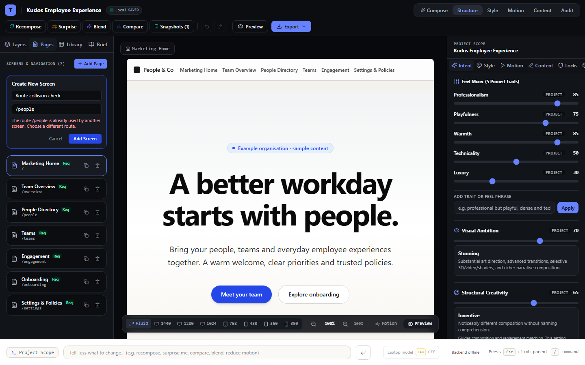

Machine reports: [`before`](evidence/step-19/before/add-screen-route-collision.json), [`after`](evidence/step-19/after/add-screen-route-collision.json), and [`valid route added`](evidence/step-19/after/add-screen-valid-route.json).

### AUD-154 — Tree mutation controls were not reachable

The prior Layers panel had no selected-node duplicate, move, or delete controls even though the mutation engine supported those operations. The fixed panel exposes Duplicate, Move up/down among siblings, and confirmed Delete. Root and locked scopes are disabled with a reason. The controls use the existing mutation and history path.

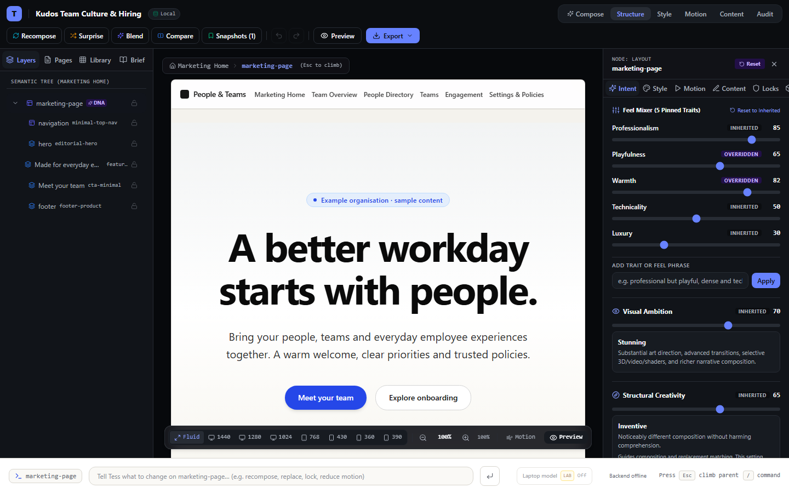

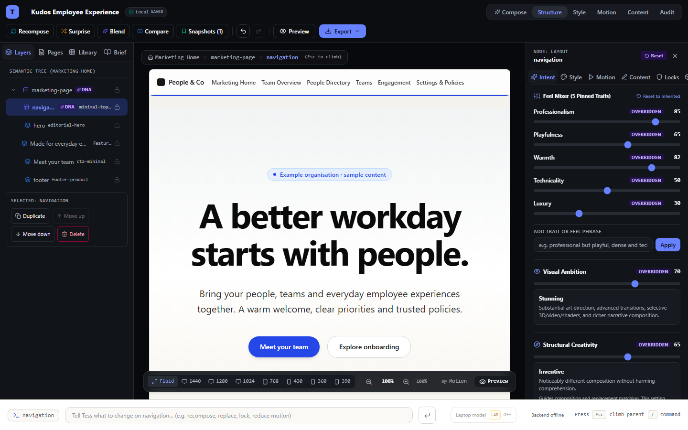

At 390 × 844, the action group remains within the mobile panel and above its bottom navigation after duplication:

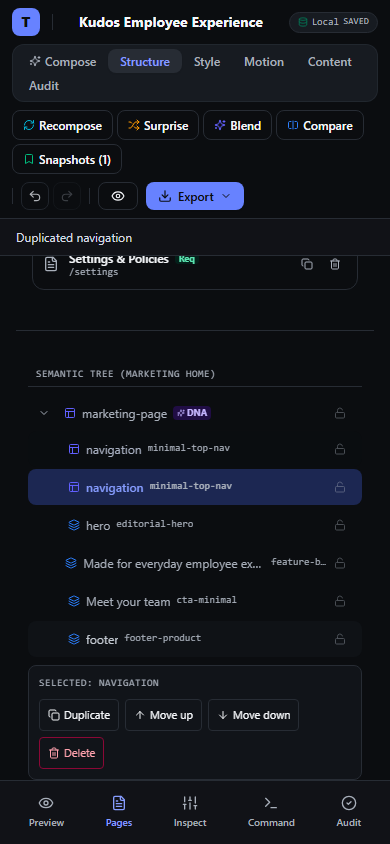

The desktop action-region Axe scan reports zero WCAG 2.0/2.1/2.2 A/AA violations. Reports: [`desktop action accessibility`](evidence/step-19/after/layer-actions-enabled.json), [`desktop mutation/export`](evidence/step-19/after/layer-mutations.json), and [`mobile action bounds and overflow`](evidence/step-19/after/mobile-layer-mutations-390x844.json).

### AUD-155 — Unspecified mutation verbs were classified as Beta

Improve, Simplify, Intensify, and Match DNA had no distinct mutation contracts or measurable outcomes, but the inventory listed them as Beta. They are now Lab until their semantics and safety criteria are specified. Hide is also Lab because node visibility has no persisted manifest field. Accessibility/performance audit suggestions remain Beta only for their deterministic, rule-specific mutations; the Audit panel labels those suggestions Beta and explains that the rendered result needs review. A visible-browser run applies the AAA contrast suggestion and the lightweight 3D/video suggestion, confirms each finding disappears, and validates the exported manifest values. The other performance suggestion and actual rendered contrast/runtime improvement remain unverified, so those matrix dimensions stay FAIL. Step 19 is complete within this local scope; public review verification remains scheduled for Step 45.

Desktop evidence at 1440 × 900:

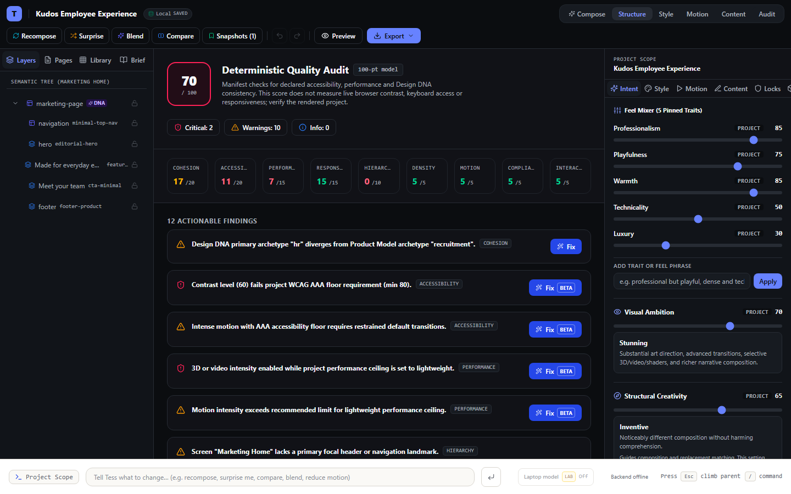

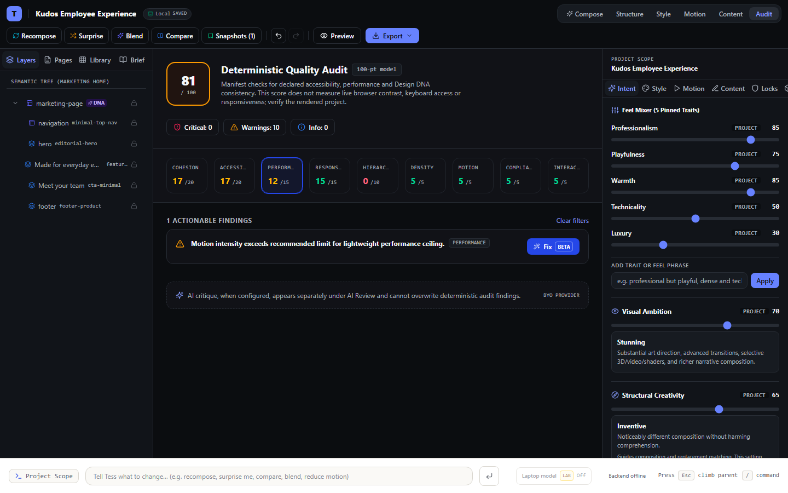

Mobile evidence at 390 × 844:

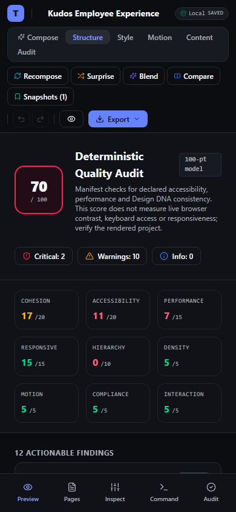

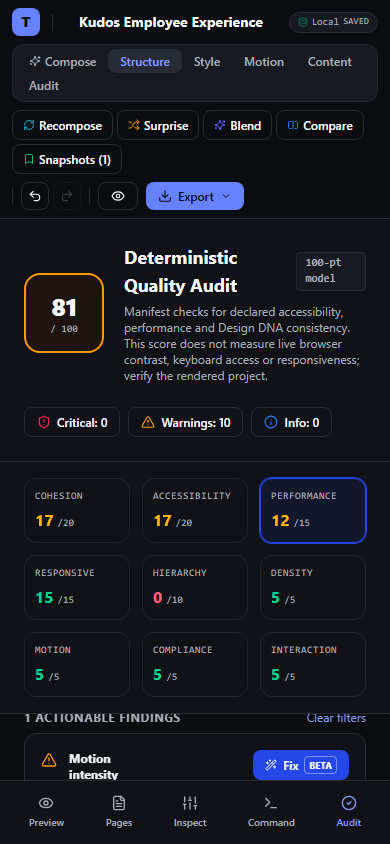

Machine reports: [desktop before](evidence/step-19/before/audit-beta-fixes-desktop-1440.json), [desktop after](evidence/step-19/after/audit-beta-fixes-desktop-1440.json), [mobile before](evidence/step-19/before/audit-beta-fixes-mobile-390.json), [mobile after](evidence/step-19/after/audit-beta-fixes-mobile-390.json), and [schema-valid exported manifest](evidence/step-19/after/audit-beta-fixes.tess.json).

The visible Workbench action panel and updated capability inventory are the evidence: [`selected layer controls`](evidence/step-19/after/layer-actions-enabled.png), [`inventory`](../docs/CURRENT_PRODUCT_INVENTORY.md), and [`Workbench contract`](../docs/WORKBENCH_SPEC.md).

## Browser workflow results

The Playwright regression covers:

- screen duplication twice, unique route/screen/node IDs, and schema-valid manifest export;
- duplicate route rejection and successful addition of a unique route;
- keyboard selection, root and ancestor-lock guard messages, and selected-layer accessibility;
- subtree duplicate with fresh recursive IDs, sibling reordering, confirmed deletion, and exact undo/redo for each operation;
- manifest tree equality with the visible tree after mutations;
- mobile reachability at 390 × 844 with no horizontal document overflow;
- Gold resource replacement through the drawer, exact resource/variant restoration through undo/redo, and manifest export.

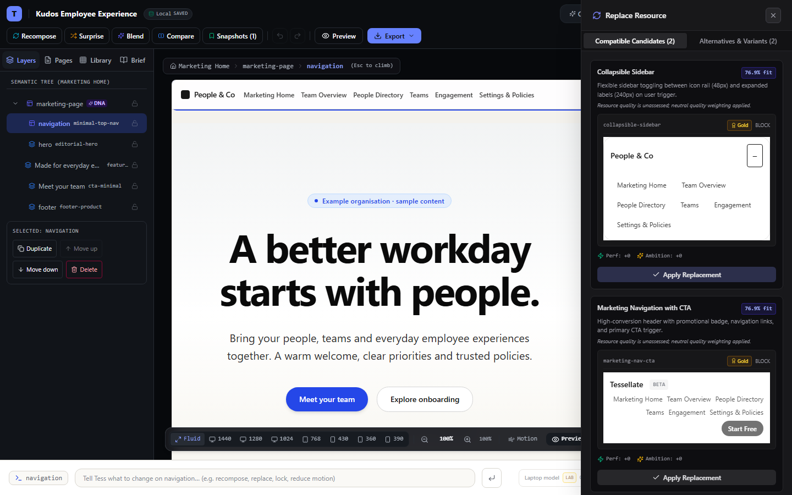

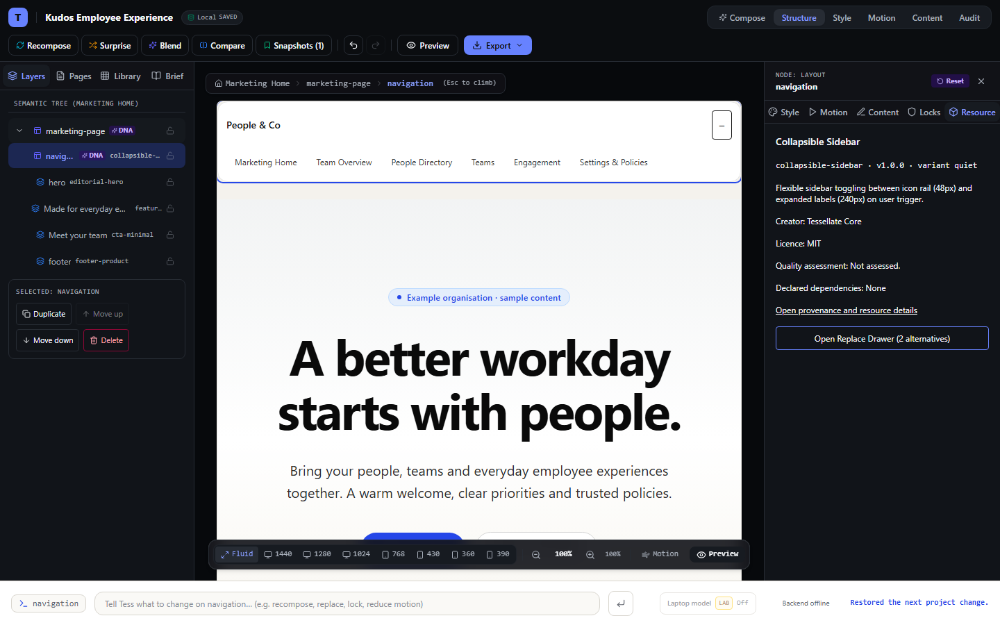

Before-fix desktop regressions failed for the intended user-facing reasons. After-fix runs passed all 6 tests in each configured Playwright project. The page-copy, Add Page, tree-mutation and replacement cases set their viewport to 1440 × 900; the Audit fix flow runs at 1440 × 900 and 390 × 844 alongside the dedicated mobile layer-action case. Browser captures report zero console errors or warnings, uncaught exceptions, failed requests, and HTTP errors. The replacement candidate was shown as Gold and the final exported node used `collapsible-sidebar` with the `quiet` variant.

## Validation

- `pnpm typecheck` — passed.
- `pnpm lint` — passed with 0 errors and 51 configured warnings.
- `pnpm test` — 912 tests across 63 files passed.
- `pnpm exec eslint packages/workbench/src/components/left-panel/PagesTab.tsx packages/workbench/src/components/left-panel/LayersTab.tsx tests/e2e/workbench-mutation-hardening.spec.ts` — passed.
- `pnpm exec playwright test tests/e2e/workbench-mutation-hardening.spec.ts --project=desktop-chrome --workers=1` — 6 passed, including visible Audit Beta fix and manifest-export checks.
- `pnpm exec playwright test tests/e2e/workbench-mutation-hardening.spec.ts --project=mobile-chrome --workers=1` — 6 passed, including visible Audit Beta fix and manifest-export checks.
- `pnpm audit:all` — passed all 16 behavioral release-gate checks, the production build (717 Astro pages), bundle budgets, 324-resource licence/provenance audit, and security/secrets audit with zero violations.

The feature matrix marks only exercised dimensions PASS; reload, persistence, broad keyboard operation, tablet widths, rendered contrast, measured runtime performance, and deployed verification remain unverified. This evidence completes Step 19's local scope, not the entire hardening programme or release readiness.
